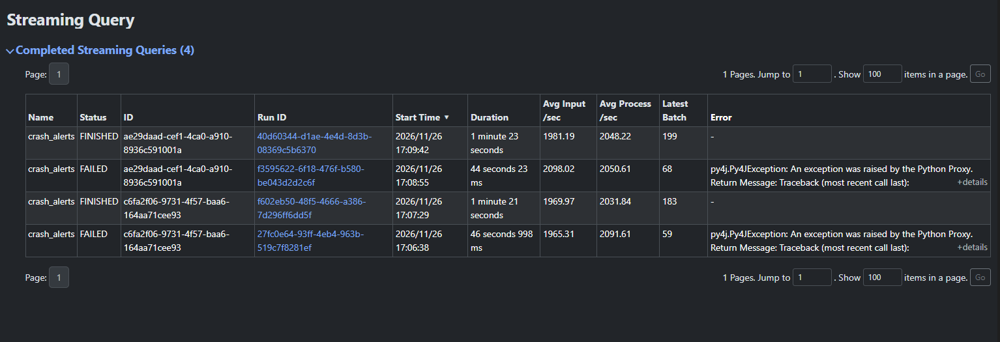
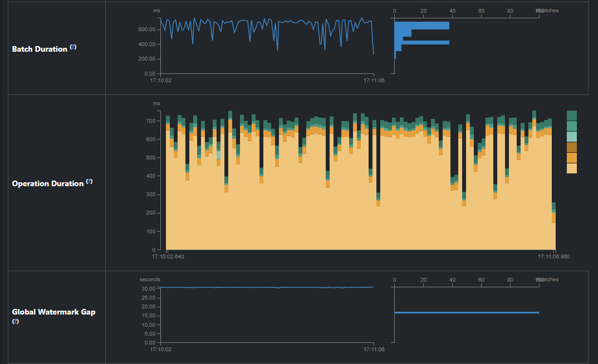
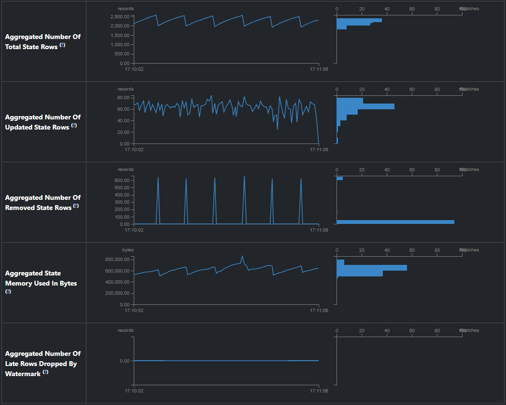
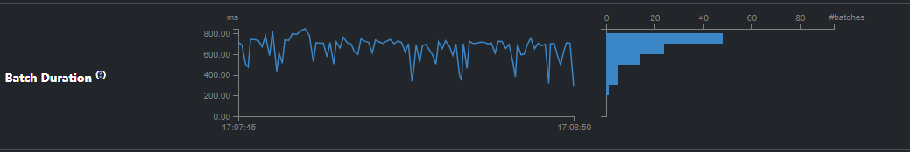
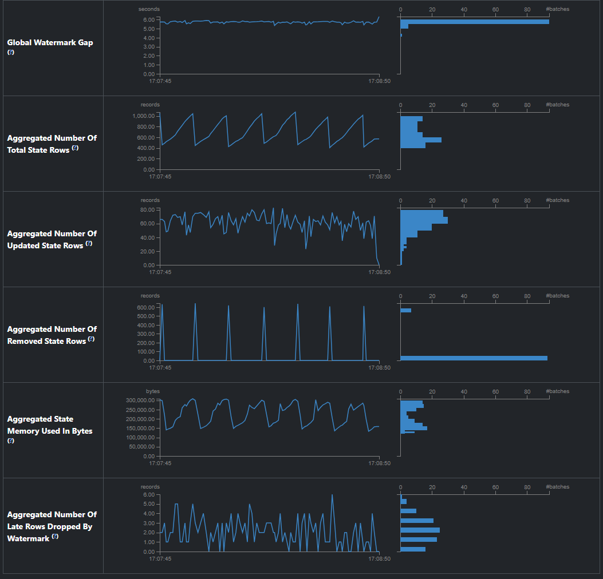

# Exercise 8


### check_all() output for the first run (before my architecture)
```
4 s  query started; writing 2,000 live records/s into `logs`
         watch it in the Spark UI (http://localhost:4040 -> Structured Streaming) and the topic crash_alerts in Kafka UI
   52 s  the query stopped right after writing alerts (simulated crash)
   54 s  query restarted from its checkpoint
  134 s  260,000 records written (13,014 late); waiting until the query has processed them

THE CHECK: 260,000 log records in 130 s, 13,014 of them late (by up to 30 s);
           your query was stopped once and restarted from its checkpoint.
THE TRUTH: 616 problems (a user with more than 2 severe crashes in one 10-second interval) in 8 intervals,
           counted over every record written, late ones included.

ON-CALL ENGINEER: a page at most 20 s after the interval ends, for 95 % of the problems
  delay of the page after the interval ends             p50 6.9 s · p95 7.1 s         MET
  problems paged                                        570 of 616 (92.5 %)
  messages in crash_alerts → pages                      641 → 570
    ignored: repeats (written again after the restart)  71
    ignored: updates (a new count, same problem)        0

OPERATIONS TEAM: a correct report, at least 99 % of the rows right, late records included
  rows correct (right problem, right count)             543 of 616 (88.1 %)           NOT MET
    missing: a problem not in the report                46
    wrong count                                         27
    extra: in the report, but not a problem             0
    for example (interval in UTC):
      user_1106  17:06:40-17:06:50   report: 3     truth: 4     1 of its crashes arrived 21 s late
      user_1239  17:06:40-17:06:50   report: 3     truth: 4     1 of its crashes arrived 21 s late
      user_1138  17:06:40-17:06:50   report: none  truth: 3     1 of its crashes arrived 16 s late
  read from                                             ops_view(messages)

RESULT: on-call engineer served (p95 7.1 s, needs ≤ 20 s) · operations team NOT served (88.1 % correct, needs ≥ 99 %)

```

### Which team is not served and why?
The requirement of the on call engineer is served quite easily, p95 is 7.1s which is much lower than the needed 20s.

The operations team can't meet the requirement of 99% correct rows, as there are some rows that arrive very late (up to 30 seconds) and as spark doesn't wait long enough, the are not considered in the end and we get worse results.


### Compare "written at" with the interval: why do all rows of an interval arrive together, and why about 7 s after its end?
```
written at  interval (UTC)       after its end   user       crashes
17:08:46    17:08:30-17:08:40            6.7 s   user_1151        3
17:08:46    17:08:30-17:08:40            6.7 s   user_1023        4
17:08:46    17:08:30-17:08:40            6.7 s   user_1088        3
17:08:46    17:08:30-17:08:40            6.7 s   user_1380        4
17:08:46    17:08:30-17:08:40            6.7 s   user_1147        3
17:08:46    17:08:30-17:08:40            6.7 s   user_1129        3
17:08:46    17:08:30-17:08:40            6.7 s   user_1444        3
17:08:46    17:08:30-17:08:40            6.7 s   user_1883        3
17:08:46    17:08:30-17:08:40            6.7 s   user_1014        3
17:08:46    17:08:30-17:08:40            6.7 s   user_1959        3
```

The rows are written 6 seconds after the end of the interval.

The rows form one interall are written together, because all the rows are kept until the interval ends + watermark.

The 7  (6.7) second delay is because of the watermark (5s) and the processing overhead (1.7s).


## Choose an Architecture

- **A: 30 seconds watermark**
    - This would be perfect for the operations team as we wait for every alert, however the on-call engineer would receive his rows too late and therefore the p95 in 20 seconds requirement would fail.
- **B: Alert early, correct later**
    - The alert is sent to the on-call engineer as soon as a micro-batch detect it. Witch a 30 seconds watermark we make sure that we get all the records and we update for the operations team as soon as there are changes. Therefore we satisfy both requirements, however if there are alerts later than 30 seconds we still miss them.
- **C: Stream for speed, batch for correctness (Lambda)**
    - The pipeline is split into two pipelines, one for fast streaming for the on-call engineer and one for operations team. With that we make sure that both requirements are met.

### Decision for B
With both B and C the requiremnts can be met. B has the disadvantage that we hold the aggregation state for 30 seconds (watermark) and for C we have two pipelines.

I decide for B as I prefer having only one pipeline and with that it is kept simpler and there are no alerts later than 30 seconds so we should be save with a 30 seconds watermark.

With that approach no team needs to wait. Because the upadate and restarts after a crash, can produce multiple messages for the same interval and key, every reader of crash_alert must deduplicate or at leat keep the latest version per key.


### Code for B
```python
def start_query():
    records = read_stream().withWatermark("event_time", "30 seconds")
    return write_alerts(crash_report(records), mode="update")
```


### check_all() for architecture B

```
 1 s  query started; writing 2,000 live records/s into `logs`
         watch it in the Spark UI (http://localhost:4040 -> Structured Streaming) and the topic crash_alerts in Kafka UI
   46 s  the query stopped right after writing alerts (simulated crash)
   48 s  query restarted from its checkpoint
  131 s  260,000 records written (13,014 late); waiting until the query has processed them

THE CHECK: 260,000 log records in 130 s, 13,014 of them late (by up to 30 s);
           your query was stopped once and restarted from its checkpoint.
THE TRUTH: 639 problems (a user with more than 2 severe crashes in one 10-second interval) in 8 intervals,
           counted over every record written, late ones included.

ON-CALL ENGINEER: a page at most 20 s after the interval ends, for 95 % of the problems
  delay of the page after the interval ends             p50 -1.4 s · p95 16.5 s       MET
    (negative: paged before the interval was over)
  problems paged                                        639 of 639 (100.0 %)
  messages in crash_alerts → pages                      856 → 639
    ignored: repeats (written again after the restart)  8
    ignored: updates (a new count, same problem)        209

OPERATIONS TEAM: a correct report, at least 99 % of the rows right, late records included
  rows correct (right problem, right count)             639 of 639 (100.0 %)          MET
    missing: a problem not in the report                0
    wrong count                                         0
    extra: in the report, but not a problem             0
  read from                                             ops_view(messages)

RESULT: on-call engineer served (p95 16.5 s, needs ≤ 20 s) · operations team served (100.0 % correct, needs ≥ 99 %)
```

As expected with this architecture both the on-call engineer and the operations team have their requirements served.

**On-call engineer:** gets 95% of the rows in 16.5 seconds, which is less than the required 20 seconds. p50 is even -1.4 because the update mode doesn't wait for the interval to end or for the watermark, it just fires out.

**Operations team:** Every row is correct (100%)

### The pager

**What it ignored:** The pager ignored 8 repeats and 209 updates.

**Why does the architecture produce those messages:** Update mode sends a new message every time a users crash count changes and restarting writes some messages again.

**What the on-call engineer would get without its if:** Without the check the engineer would get duplicate pages after the restart.

### Screenshot: Query List



The ID stays the same before and after the crash, however the Run ID changes. 

**What the restart reused form the checkpoint:**
- The query ID
- Commited micro-batch progress and Kafka offsets
- Aggregation state and watermark

The checkpoint behaves like the progress tracking form exercise 7.


### Screenshot: Batch Duration and Global Watermark Gap


**Micro-batch duration:** 400-700ms, this is the time the on-call engineer has to wait for its rows (its the time the micro-batch needs to process the data), after they arrived to spark. (time between arriving in spark and arriving at engineer)

**Global Water Mark Gap:** 30 seconds, this is the absolute maximum the operations team has to wait for a row. In general we wait a maximum of 30 seconds for new rows.


### Screenshot: Aggregated Number Of Total State Rows and Aggregated Number Of Late Rows Dropped By Watermark



**What is kept:** Sprak keeps the active aggregation state entries in memory for windows that have not passed the 30 seconds watermark yet. 

**What is lost:** Because I set the watermark to 30 seconds and there are no new rows after 30 seconds, everything is captured and there are no rows dropped by the watermark.


### Comparison First run to architecture B run
- The batch duration rate stays roughly the same
- The global watermark gap is around 6 seconds instead of 30 (configuration)
- There are some rows dropped by the watermark, as there are rows that arrive after the 6 second watermark.



